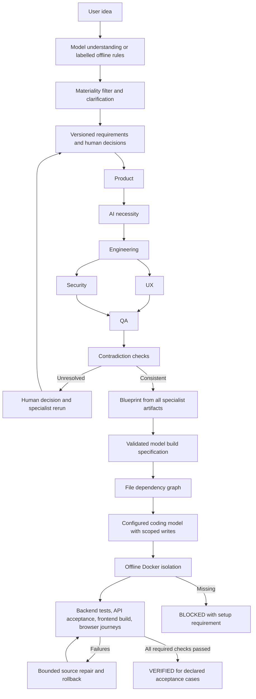

# PROJECTFORGE AI — Current Architecture

Updated 2026-10-02. This describes implemented code; future capabilities are listed separately.

## Purpose and supported scope

PROJECTFORGE turns a software idea into structured requirements, specialist planning,
a machine-readable build specification and generated source. The model-driven MVP
supports React/TypeScript/Vite + FastAPI websites and backend APIs.
It does not claim universal project generation or production readiness.

## Execution flow



## Agents and model adapter

`app/agents/pipeline.py` invokes the existing six specialist classes through their
validated JSON harnesses. Product precedes AI/ML, which precedes Engineering.
UX and Security can run concurrently; QA waits for their dependencies.
Each specialist receives requirement provenance, decisions and user constraints.
Completion events are emitted only after validated output exists.

`app/agents/model_client.py` supplies Gemini through the configured model.
Call count, input size, output-token and request-duration limits are configurable.
Token usage is recorded when supplied by the provider; no monetary cost or
statistically calibrated correctness percentage is fabricated.

Without credentials, specialist analysis is BLOCKED. Understanding may fall back
to labelled heuristic suggestions, with generated features tagged as INFERENCE.
There is no installed local model or Qwen integration.

Conflict scoring is available as a planning utility, but unresolved contradictions
block compilation. Human resolutions become constraints and invalidate downstream
outputs; specialists must rerun rather than silently retaining contradictory specs.
Confidence formulas are internal heuristics, not measured probabilities.

## Requirements, persistence and events

Clarification answers resolve their targeted unknown into a user requirement.
Duplicate answers are rejected. Changes increment the context revision and
invalidate previous planning/build outputs. Generated workspaces are separated
by project and context version.

SQLite snapshots, snapshot history and ordered event records are maintained in
`backend/data/projects.sqlite3`. SSE subscribers independently replay the same
event log, with sequence IDs and Last-Event-ID support. Event notifications from
the coding worker are marshalled onto the API event loop.

This is a **single API worker** implementation. Active-operation guards prevent
overlapping runs in that process. On restart, active saved runs become INTERRUPTED;
automatic mid-task resume and distributed scheduling remain future work.

## Build and execution

The model compiler validates startup files, file paths/dependencies, provenance,
and acceptance coverage. Coding tasks can write only their declared files.
Source writes use atomic replacement. Test contracts live under `.projectforge`
and cannot be edited by the coding/repair task scope.

A separate deterministic TEMPLATE generator remains for scaffold development
and tests. It does not represent arbitrary AI-generated website functionality.

Generated programs never execute on the host. The executor requires the trusted
`projectforge-runtime:local` image built from `backend/sandbox/Dockerfile`.
It stages plain source files, rejects linked paths, mounts them read-only,
disables external networking, drops capabilities, uses an unprivileged user,
and bounds memory, CPU, process count, source size, output capture and duration.
Dependencies are preinstalled in the runtime. Unsupported dependencies fail
verification instead of triggering unrestricted installation.

## Verification and repair

Required checks are backend tests with at least one passing test, frozen HTTP
acceptance cases, frontend compilation for websites, and declared browser journeys.
The platform owns the test harnesses; case data is compiled before coding.
Browser journeys assert visible results and detect page errors.

Only all required checks passing produces VERIFIED. BLOCKED, FAILED and
REQUIRES_HUMAN are separate outcomes. The verification report fingerprints source
files; automatic editor launch refuses stale or incomplete verification.
Load, security scans, accessibility and untested requirements remain limitations.

The repair loop allows at most three attempts. Repairs are restricted to declared
source files; tests and acceptance contracts cannot be weakened. Failed backend
repairs restore original source and retest it. The debugger has a model adapter
and a limited deterministic fallback. Frontend/browser/acceptance failures currently
require human review rather than a complete cross-check repair cycle.

## Local setup and running

Use PowerShell from `D:\capstone_project`:

```powershell
.\.venv\Scripts\python.exe -m pip install -r backend\requirements.txt
Copy-Item backend\.env.example backend\.env
# Edit backend/.env locally to set GEMINI_API_KEY. Never commit the key.
docker build -t projectforge-runtime:local backend/sandbox
```

Run the backend from `backend`:

```powershell
..\.venv\Scripts\python.exe -m uvicorn app.main:app --host 127.0.0.1 --port 8000
```

Run the frontend from `frontend`:

```powershell
npm run dev -- --host 127.0.0.1 --strictPort
```

The frontend is at http://127.0.0.1:3000 and API docs at
http://127.0.0.1:8000/docs. API requests use the Vite proxy.
Autonomous mode proceeds from planning to build. Guided mode requires explicit
`POST /api/projects/{id}/approve-build` with the current context version.

## Evidence and outstanding work

The pre-change backend baseline was 153 passing tests. The regression suite adds
checks for real specialist invocation, missing-model handling, isolation gates,
clarification resolution, independent event replay, path scope, stale fingerprints
and frontend failure preventing verification. See IMPLEMENTATION_STATUS.md.

The Docker image, browser harness and live model-generated project must be tested
on a configured machine before claiming a successful end-to-end generation demo.
Single-agent versus multi-agent benchmarking, calibrated confidence, full crash
resume, richer dependency support and frontend redesign remain future work.
